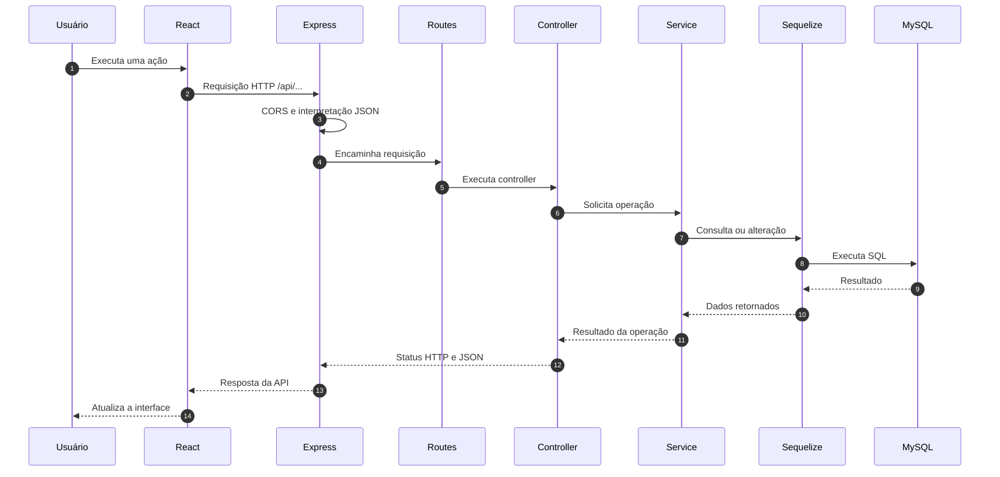

## Arquitetura do Back-end

O back-end do **Pares & Patinhas** utiliza uma arquitetura em camadas, construída com Node.js, Express, Sequelize e MySQL.

O objetivo é separar as responsabilidades da aplicação, facilitar a manutenção do código e permitir o desenvolvimento paralelo das funcionalidades pela equipe.

### Fluxo de requisição e resposta



### Responsabilidades das camadas

| Camada | Responsabilidade |
|---|---|
| React | Exibe a interface e realiza requisições HTTP |
| Express | Configura a API e seus middlewares |
| Routes | Direciona requisições aos controllers |
| Controllers | Recebem dados HTTP e enviam respostas |
| Services | Executam regras de negócio |
| Models | Representam as entidades do banco |
| Sequelize | Faz a comunicação com o MySQL |
| MySQL | Armazena os dados da aplicação |
| Middlewares | Tratam autenticação, erros e requisições |

### Módulos da aplicação

A API será organizada nos seguintes módulos:

| Módulo | Prefixo planejado | Funcionalidades |
|---|---|---|
| Autenticação | `/api/auth` | Cadastro, login e JWT |
| Tutores | `/api/tutors` | Perfil e atualização de dados |
| Animais | `/api/animals` | Cadastro, edição, consulta e exclusão |
| Farejar | `/api/discovery` | Descoberta e interação com animais |
| Matches | `/api/matches` | Verificação de curtidas recíprocas |

**Observação:** os prefixos acima representam o contrato planejado para as duplas. Os endpoints serão implementados durante o desenvolvimento.

### Exemplo implementado: verificação da API

**Requisição:**

`GET /api/health`

**Resposta HTTP 200:**

```json
{
  "status": "ok",
  "message": "API Pares & Patinhas funcionando!"
}
```

Esse endpoint confirma que o servidor Express está respondendo.

### Exemplo planejado: login do tutor

1. O tutor preenche e-mail e senha no React.
2. O React envia uma requisição para `/api/auth/login`.
3. A rota encaminha a requisição ao `authController`.
4. O controller chama o `authService`.
5. O service consulta o tutor usando o model Sequelize.
6. A senha informada é verificada com bcrypt.
7. Se as credenciais forem válidas, o servidor gera um JWT.
8. O controller retorna a resposta ao React.
9. O React atualiza o estado de autenticação.

Esse fluxo será implementado pela dupla responsável por autenticação.

A API nunca deverá retornar o hash da senha do tutor.

### Tratamento de erros

A API utiliza middlewares para padronizar respostas de erro.

Exemplo de resposta:

```json
{
  "success": false,
  "message": "Não foi possível concluir sua solicitação."
}
```

Erros internos inesperados podem retornar o status HTTP 500, mas sem expor stack traces, consultas SQL ou detalhes técnicos ao cliente.

O front-end será responsável por apresentar mensagens amigáveis ao usuário.


## Instalação e execução do Back-end

Este guia apresenta os passos necessários para configurar e executar a API REST do **Pares & Patinhas** em ambiente de desenvolvimento.

### Pré-requisitos

Antes de começar, tenha instalado:

- Node.js e npm
- MySQL Server 8
- Git
- VS Code ou outro editor de código

### 1. Acessar a pasta do back-end

Após clonar o repositório, entre na pasta do projeto:

```bash
cd pares-e-patinhas/backend
```

Se já estiver na raiz do projeto, basta executar:

```bash
cd backend
```

### 2. Instalar as dependências

```bash
npm install
```

Esse comando instala as dependências definidas no `package.json`, incluindo Express, Sequelize, MySQL2 e as ferramentas de desenvolvimento.

### 3. Configurar as variáveis de ambiente

Crie o arquivo `.env` a partir do modelo disponibilizado:

```bash
cp .env.example .env
```

No Windows, utilizando Git Bash, esse comando também funciona.

Configure o `.env` com os dados da sua instalação local do MySQL:

```env
PORT=3001

DB_HOST=localhost
DB_PORT=3306
DB_USER=root
DB_PASSWORD=sua_senha_local
DB_NAME=pares_e_patinhas

FRONTEND_URL=http://localhost:5173
JWT_SECRET=defina_uma_chave_secreta_forte
```

**Importante:** nunca compartilhe ou versione o arquivo `.env`. Cada integrante deve utilizar suas próprias credenciais.

### 4. Criar o banco de dados

Com o MySQL Server iniciado, execute:

```bash
npm run db:create
```

Esse comando cria o banco definido em `DB_NAME`.

Se o banco já existir, não será necessário criá-lo novamente.

### 5. Executar as migrations

```bash
npm run db:migrate
```

As migrations criam ou atualizam a estrutura das tabelas do banco de dados.

Para verificar quais migrations foram executadas:

```bash
npm run db:status
```

As migrations aplicadas aparecerão com o status `up`.

### 6. Iniciar o servidor

Para executar a API em ambiente de desenvolvimento:

```bash
npm run dev
```

O Nodemon reinicia o servidor automaticamente quando os arquivos monitorados são alterados.

Com a conexão configurada corretamente, o terminal deverá apresentar mensagens semelhantes a:

```text
MySQL conectado com sucesso!
Servidor rodando na porta 3001
```

### 7. Testar a API

Com o servidor iniciado, acesse:

`http://localhost:3001/api/health`

Resposta esperada:

```json
{
  "status": "ok",
  "message": "API Pares & Patinhas funcionando!"
}
```

Esse endpoint verifica se o servidor HTTP está respondendo. A conexão com o MySQL é verificada durante a inicialização do servidor.

### 8. Executar o Front-end

Abra outro terminal e retorne à raiz do projeto:

```bash
cd ..
```

Instale as dependências do React, caso ainda não tenha feito:

```bash
npm install
```

Inicie o Vite:

```bash
npm run dev
```

Por padrão, o Vite disponibiliza a aplicação em:

`http://localhost:5173`

O front-end e o back-end devem permanecer em execução em terminais separados.

### Scripts disponíveis

| Comando | Descrição |
|---|---|
| `npm run dev` | Inicia a API com Nodemon |
| `npm start` | Inicia a API com Node.js |
| `npm run db:create` | Cria o banco de dados |
| `npm run db:migrate` | Executa migrations pendentes |
| `npm run db:status` | Consulta o estado das migrations |
| `npm run db:undo` | Reverte a última migration |

**Atenção:** utilize `db:undo` somente quando necessário e após verificar o impacto sobre os dados existentes.

### Organização do trabalho em equipe

O projeto utiliza branches para permitir o desenvolvimento paralelo.

- `main`: versão estável do projeto.
- `develop`: branch de integração da equipe.
- `feat/*`: desenvolvimento de funcionalidades.
- `fix/*`: correção de problemas.
- `chore/*`: configurações, infraestrutura e manutenção.

Cada dupla deve desenvolver suas funcionalidades em uma branch específica e abrir um Pull Request para `develop`.

Antes de solicitar o merge, é recomendado verificar se o servidor inicia corretamente, se as migrations estão funcionando e se não existem arquivos sensíveis no commit.

### Segurança

- Nunca versionar `.env` ou senhas reais.
- Não armazenar senhas de tutores em texto puro.
- Utilizar bcrypt para gerar hashes de senhas.
- Proteger endpoints privados com autenticação JWT.
- Não retornar informações internas do servidor nas respostas de erro.
- Validar os dados recebidos antes de persistir no banco.
